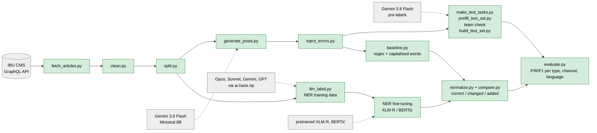

# Multichannel News Adaptation

Detecting changed names, dates and numbers in LLM rewrites of IBU news. 
Developed as part of the Natural Language Processing course at International Burch University (Fall 2026).

## Setup
Requires Python 3.12.

```bash
git clone https://github.com/Haris0059/multichannel-news-adaptation.git
cd multichannel-news-adaptation
python3 -m venv .venv
source .venv/bin/activate
pip install -r requirements.txt
pre-commit install
```

Activate the venv again in every new terminal.

## Pipeline

Each step reads the previous step's file and writes its own. Green steps are our own work, grey steps are external models or services.



NER fine-tuning is the main method and is not built yet. Test set v1 (60 posts) is pre-labelled by Gemini 3.8 Flash and corrected by Claude with decisions D1-D4 from `docs/labelling_rules.md`; the team has not checked it by hand yet, so first results are provisional.

Stages, owners and status are in `docs/pipeline.md`.

## Data

Article text and generated posts are not committed, because IBU's terms forbid redistribution. The only exception is the hand-labelled test set. Rebuild everything from the repo root:

```bash
python src/fetch_articles.py   # data/raw/articles_<date>.json, 166 articles
python src/clean.py            # data/processed/cleaned.jsonl
python src/split.py            # data/split.json, 70/15/15 by article, seed 42
python src/analyze.py          # results/figures/
```

## Posts and test set

`generate_posts.py` and `llm_label.py` call Haris's API. Put the key in a gitignored `.env` file in the repo root: `HARIS_AI_KEY=sk-hr-...`.

```bash
python src/generate_posts.py        # test split: 25 articles x 3 channels x 2 languages x 3 variants
python src/generate_posts.py train  # train split, gemini with the fact rule only
python src/inject_errors.py         # one changed fact in a third of the clean test posts
python src/make_test_tasks.py       # 60 posts, 20 per annotator, in data/processed/test_tasks/
python src/prefill_test_set.py      # pre-filled check sheets in data/processed/test_check/
```

The 3 test variants are Gemini 3.8 Flash with the fact rule (the real setup), Gemini without the rule (to measure the prompt's effect) and Ministral 8B without the rule (more errors). `generate_posts.py` continues where it stopped if it is run again.

`prefill_test_set.py` uses Gemini 3.8 Flash, which is not one of the NER training labellers, to list every fact in each post with its type, label and matching article fact. Each of us then checks our own sheet, `data/processed/test_check/<name>.csv`, one row per fact, following `docs/labelling_rules.md`:

1. Fix a wrong `type` or `label` (`correct`, `changed`, `added`), or delete a row that is not a fact.
2. Read the post and add a row for every fact the model missed (`post_id`, `fact` copied exactly from the post, `type`, `label`).
3. Check every `correct` label against the article: the pre-labeller missed 5 of the 15 injected errors.

```bash
python src/build_test_set.py   # data/processed/test_set.jsonl (committed)
python src/baseline.py         # results/predictions/baseline.jsonl
python src/evaluate.py         # results/evaluation/metrics.csv, rates.csv, errors.csv
```

## LLM labelling

Put Haris's API key in a gitignored `.env` file in the repo root (`HARIS_AI_KEY=sk-hr-...`), then run `python src/llm_label.py` to label the train-split articles with every model in `MODELS`, or `python src/llm_label.py <model>` for one model.
Labels are saved per model in `data/processed/llm_labels/`; if the quota runs out, run it again later and it continues where it stopped.
