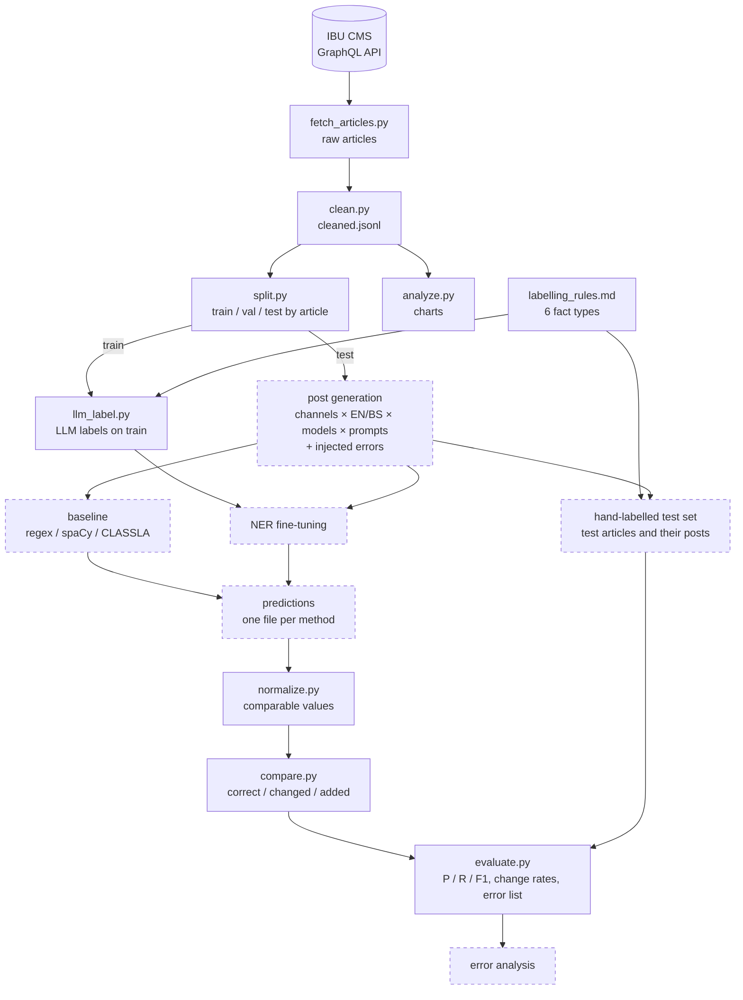

# Pipeline

Draft · 22.11.2026 · Abdurrahman

How an IBU article becomes a score. Solid boxes are written; dashed boxes are still to do.

## Stages and owners

| Stage | Files | Owner | Status |
| --- | --- | --- | --- |
| Data: fetch, clean, split, analysis | `src/fetch_articles.py`, `src/clean.py`, `src/split.py`, `src/analyze.py` | Haris | Done |
| Annotation schema | `docs/labelling_rules.md` | Fadil | v0.2 draft, 3 open questions |
| LLM labels for NER training | `src/llm_label.py` | Fadil | Run on the train split by Haris (22.11); the Gemini file is empty |
| NER fine-tuning | | Fadil | To do |
| Post generation and injected errors | `src/generate_posts.py`, `src/inject_errors.py` | Haris, written by Fadil | Written 22.11, tested with a fake API, not run yet |
| Test set | `src/make_test_tasks.py`, `src/prefill_test_set.py`, `src/build_test_set.py` → `data/processed/test_set.jsonl` | Haris, labelled by all | 60 posts pre-labelled by Gemini 22.11; team check to do |
| Baseline | `src/baseline.py` | Haris, written by Fadil | Written 22.11, not run on real posts |
| Normalisation, comparison, evaluation | `src/normalize.py`, `src/compare.py`, `src/evaluate.py` | Abdurrahman | Done, 170 tests |
| Annotation, cross-review, error analysis | | All | To do |

## What flows between stages

- A **fact** is a span `{text, type, start, end}` with one of PERSON, ORG, LOC, DATE, TIME, NUMBER.
- Each method finds facts in the source article and in the post. `compare.py` labels every post fact as `correct`, `changed` or `added`.
- `evaluate.py` scores those labels against the test set, where `changed` and `added` are the errors to catch. It also reports how often each model and prompt changes facts, leaving out the posts with injected errors.
- Most source articles are English. Four are Bosnian, so `compare_facts` takes the source language as an argument.
